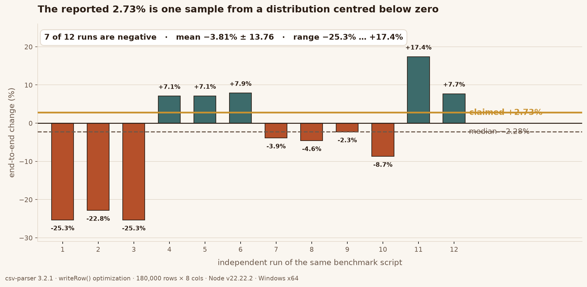
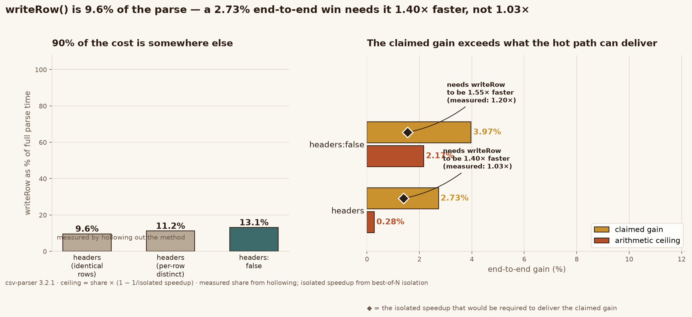

# csv-parser writeRow optimization — audited study

A minimal, reproducible benchmark + audit of a `writeRow()` micro-optimization for
[`mafintosh/csv-parser`](https://github.com/mafintosh/csv-parser) **3.2.1** (MIT).

This repo exists because the *first* version of this study claimed **2.73% faster**.
That claim does not survive measurement — see [`docs/FINDINGS.md`](docs/FINDINGS.md).
The corrected numbers, the harness that produces them, and the reasoning that
overturns the original conclusion are all here.



Re-running the same script 12 times in independent processes gives a median of
**−2.28%**, with 7 of 12 runs negative and a range of −25.3% … +17.4%. The claimed
number is one draw from that spread.



Hollowing out `writeRow` shows it accounts for only ~10% of parse time. That caps the
end-to-end gain far below the claim, and no amount of re-measuring changes the
arithmetic.

## Layout

```
upstream/index.js        byte-identical to npm csv-parser@3.2.1 (verified)
optimized/index.js       the change under test
audit/arms/armA.js       == upstream
audit/arms/armB.js       only reduce() → for loop (map kept)
audit/arms/armC.js       == optimized (both changes)
benchmark.js             three-arm attribution + writeRow cost share
test/verify.js           parity tests original vs optimized
audit/                   probes: isolated writeRow, GC counters, distribution, poisoning
docs/optimization.patch  applies cleanly to real 3.2.1 (git apply --check verified)
docs/FINDINGS.md         what was measured and what it means
LICENSE                  upstream MIT, copyright (c) 2014 Mathias Buus
```

## Run

```sh
npm test                 # parity: fixtures + 350-row randomized, split chunks
npm run bench            # three-arm attribution + end-to-end ceiling
```

Optional controls:

```sh
HEADERS=false npm run bench      # numeric-key mode (the path that actually benefits)
ROWS=180000 COLS=8 ROUNDS=12     # size / sampling
DATA=identical npm run bench     # the degenerate input that produced the original claim
ISOLATED_SPEEDUP=1.22 npm run bench   # feeds probe-writerow2.js result into the ceiling calc
MODE=inproc npm run bench        # single-process interleaved (usually worse)
```

Audit probes:

```sh
node audit/probe-writerow2.js                  # writeRow in isolation, best-of-N
VARIED=1 node audit/probe-writerow2.js         # same, per-row-distinct values
node audit/probe-repeat-bench.js               # rerun the whole benchmark N times; look at the spread
node audit/probe-varied-share.js               # writeRow cost share, both input distributions
node audit/edge-diff.js                        # 26 semantic edge cases, field-by-field
node audit/poison-test.js                      # inject 4 bugs; does the test suite catch them?
node --trace-gc audit/probe-gc.js arms/armA.js normal   # scavenge counts (allocation evidence)
```

## Result in one paragraph

`writeRow` really does allocate one less array per row in `headers: false` mode — the
scavenge count drops from 63 to 57 (−9.5%) and the isolated speedup is **1.22×**
(reproducible, sd ≈ 0.06). But `writeRow` is only **~18%** of end-to-end parse time in
that mode, so the ceiling on any end-to-end gain is **~2%**, and the in-stream signal is
below this machine's noise floor. In the default `headers` mode there is **no reproducible
gain at all**: the C/B arm is a *functional* null control (both halves evaluate the same
expression) yet still measured 1.0171 — i.e. the noise floor is 1.7%, and the claimed
1.03× is indistinguishable from it. Details and every raw sample: [`docs/FINDINGS.md`](docs/FINDINGS.md).

## License

MIT, same terms as upstream. The upstream copyright notice and full license text are
retained in `LICENSE`.
